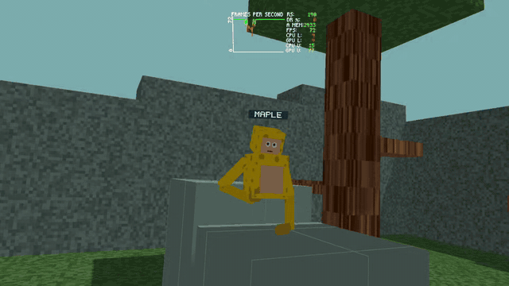

# Rive VR



A small, standalone Meta Quest playground built to explore **Rive as a VR
rendering and gameplay runtime**. The current APK is about **800 KB**,
including the scene, and runs at up to **207 Hz** on Quest 3.

## What we're doing

A thin C++ OpenXR host handles headset/controller tracking and local
networking. It passes poses into a Rive ViewModel; a Luau script handles
movement, collisions, scene geometry, and stereo rendering through Rive's
GPU Canvas. Rive produces both eye images, which the host submits to OpenXR.

The playground includes:

- Gorilla Tag style movement: push against surfaces with your hands to move,
  jump, and climb.
- Trees, branches, decks, practice steps, and a grid-lined central court.
- Multiplayer over the same Wi-Fi network, with interpolated head/hand poses
  and small fallback name plates.
- Right controller **A** cycles the refresh rate (up to 207 Hz on Quest 3,
  shown briefly in front of you); **B** toggles foveated rendering.

## Why we're doing it

We're testing how much of a responsive VR experience can live inside a
`.riv` file, with a small native host and fast iteration in Rive.

Keeping the download tiny is part of the experiment. Materials are
procedural, name plates use a small vector pixel font, and the build omits
unused text, layout, and image-decoding features. Static linking, symbol
stripping, and compression keep the APK compact. The scene is bundled, so
there are no extra asset downloads or servers to set up.

This is an experimental playground, not a complete game engine.

## Build and run

The scripts currently target macOS with the Android SDK/NDK, JDK, Ninja,
Python 3, and an Android debug signing key installed. The Rive runtime
checkout must be present in `third_party/rive-runtime`.

```bash
bash tools/fetch_openxr.sh
bash tools/build_apk.sh
adb install -r build/rivevr.apk
adb shell am start -n so.fluid.rivevr/android.app.NativeActivity
```

The first build compiles a minimal, size-optimized Rive runtime with the
patches in `tools/patches/`. Recommended headset settings:

```bash
adb shell "setprop debug.rivevr.direct 1; setprop debug.rivevr.msaa 1; setprop debug.rivevr.scale 1.2; setprop debug.rivevr.hz 207"
```

See [AGENTS.md](AGENTS.md) for how it all works: frame flow, build details,
every `debug.rivevr.*` property, refresh rates, and performance notes.

## Edit the scene

- `content/scripts/VRScene.luau` — level, locomotion, players, and rendering.
- `content/shaders/scene_lit.wgsl` — procedural materials and name plates.
- `src/` — OpenXR host and LAN multiplayer.

Sync changes into the open Rive document with `tools/rive_mcp.py`, export
with `bash tools/export_riv.sh`, then rebuild the APK (or `bash tools/push.sh`
for a scene-only push).

## License

Our code is [0BSD](LICENSE). The APK also contains the Rive runtime, Luau,
libhydrogen and Android's native_app_glue under their own permissive
licenses; see [THIRD_PARTY_NOTICES](THIRD_PARTY_NOTICES).

This is an independent project, not affiliated with or endorsed by Rive.
